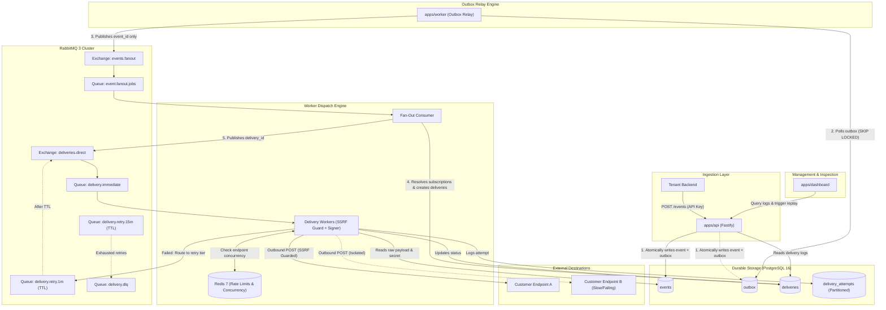
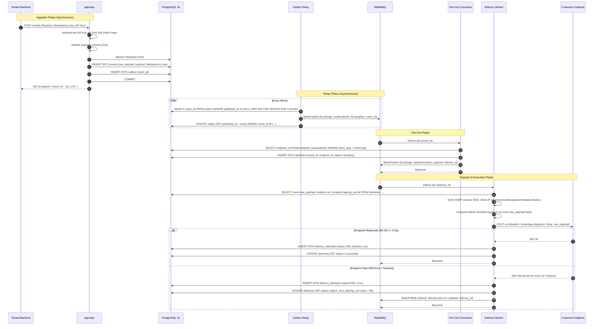

# HookRelay: High-Level Design (HLD)

## 1. Problem Statement
Modern distributed platforms require event-driven outbound webhook systems to notify customer and partner services of business events (e.g., payments, account updates, shipments). However, implementing outbound webhooks directly inside application monoliths or microservices introduces severe architectural risks:

1. **Dual-Write Vulnerability & Event Loss:** Storing an internal business change in a relational database while simultaneously publishing an HTTP request or queue message leads to partial failure states (database commits but network publish fails, or vice versa).
2. **Head-of-Line (HoL) Blocking:** External subscriber endpoints have wildly unpredictable latencies and availability. A single slow subscriber (e.g., lingering for 15 seconds before timing out) can exhaust application thread and connection pools, degrading core business transactions and stalling deliveries to healthy subscribers.
3. **Security & Server-Side Request Forgery (SSRF):** Allowing arbitrary tenant-configured webhook URLs opens internal infrastructure, cloud metadata endpoints (`169.254.169.254`), and loopback addresses to SSRF, private network scanning, and DNS rebinding attacks.
4. **Delivery Guarantees & Duplicate Management:** Over unreliable public networks, network timeouts leave publishers uncertain whether a destination received an event. Without disciplined at-least-once delivery, cryptographic signing, and consumer idempotency guidelines, data inconsistency and duplicate processing bugs proliferate.
5. **Observability & Operational Burden:** Tenants and their customers require granular, searchable, replayable delivery logs with status codes, latency timings, and error snippets without burdening core application databases.

HookRelay solves these challenges as a dedicated, multi-tenant outbound webhook engine. A tenant backend publishes an event once; HookRelay durably records it, cryptographically signs it, fans it out to all subscribed endpoints, isolates traffic, handles automated retries with backoff, and maintains a searchable audit log.

---

## 2. Requirements

### Functional Requirements
- **Event Ingestion:** High-throughput, authenticated endpoint (`POST /events`) validating tenant API keys, payloads, and optional idempotency keys.
- **Subscription Fan-Out:** Automatic matching and routing of ingested events to all active subscriber endpoints by exact event type or wildcard (`*`).
- **Cryptographic Signing:** Standardized HMAC-SHA256 signature computation over verbatim wire bytes, delivered via HTTP headers, with zero-downtime secret rotation support.
- **Reliable Dispatch & Tiered Retries:** At-least-once delivery guarantee with automated exponential backoff and randomized jitter across tiered retry queues.
- **Dead-Letter Queue (DLQ) & Manual Replay:** Unrecoverable deliveries transition to `dead`; tenants can trigger manual replay via API or dashboard.
- **Delivery Audit Log:** Searchable log of deliveries and attempts containing HTTP status, latency, error details, and truncated response snippets.
- **Tenant Isolation:** Every tenant's subscriptions, secrets, deliveries, and query boundaries are strictly isolated.

### Non-Functional Requirements
- **Latency Target:** p95 first-attempt dispatch latency $\le 2.0\text{ seconds}$ from HTTP ingestion acknowledgment to initial external HTTP call.
- **Availability:** $99.95\%$ uptime for the ingestion API (`apps/api`).
- **Durability:** Zero event loss once `POST /events` returns `202 Accepted` / `201 Created`. Events and outbox entries are committed to PostgreSQL WAL before acknowledgment.
- **Security:** Strict SSRF protection on all outbound requests (pre- and post-DNS resolution validation), zero-secret logging, and hashed API key storage.
- **Isolation (No HoL Blocking):** A completely degraded or stalled endpoint must never slow down deliveries to other endpoints or tenants.

---

## 3. Back-of-the-Envelope Capacity Estimation

### Given Parameters
- **Active Tenants:** $100$
- **Daily Ingestion Volume:** $10,000,000\text{ events/day}$
- **Average Fan-Out Factor:** $3\text{ endpoints per event}$
- **Total Deliveries/Day:** $10\text{M} \times 3 = 30,000,000\text{ deliveries/day}$
- **Latency Target:** First-attempt p95 delivery latency $\le 2.0\text{s}$

### Explicit Assumptions
> [!NOTE] Assumed Traffic Profile & Sizing Model
> 1. **Diurnal Peak Window:** Traffic is not uniformly distributed over 24 hours ($86,400\text{s}$). We assume $70\%$ of daily events arrive during an $8\text{-hour}$ peak window ($28,800\text{s}$).
> 2. **Payload Size:** Average raw JSON payload size is $2\text{ KB}$; maximum allowed payload size is $64\text{ KB}$.
> 3. **Success & Retry Distribution:**
>    - $95\%$ of deliveries succeed on the first attempt ($28.5\text{M}$ attempts).
>    - $5\%$ fail and enter retry queues ($1.5\text{M}$ deliveries).
>    - Retried deliveries average $2.5$ additional attempts before succeeding or exhausting retries $\approx 3.75\text{M}$ retry attempts.
>    - Total daily delivery attempts $\approx 30\text{M} + 3.75\text{M} \approx 33.75\text{M}\text{ attempts/day}$.
> 4. **External Endpoint Latency:** External destination servers respond with a p50 latency of $250\text{ms}$ and p95 latency of $1,500\text{ms}$. Hard outbound timeout is capped at $5.0\text{s}$.

### Calculated Throughput
- **Average Ingestion Rate:** $10,000,000 / 86,400 \approx 116\text{ events/sec}$
- **Peak Ingestion Rate:** $(10,000,000 \times 0.70) / 28,800 \approx 243\text{ events/sec}$
- **Average Delivery Dispatch Rate:** $116 \times 3 \approx 348\text{ deliveries/sec}$
- **Peak Delivery Dispatch Rate:** $243 \times 3 \approx 730\text{ deliveries/sec}$ (first attempts) $+ \approx 90\text{ retries/sec} \approx 820\text{ total outbound HTTP req/sec}$.

### Network Bandwidth
- **Inbound Ingestion Bandwidth:**
  - Peak: $243\text{ events/sec} \times 2\text{ KB} \approx 486\text{ KB/s} \approx 3.9\text{ Mbps}$
- **Outbound Delivery Bandwidth:**
  - Peak: $820\text{ requests/sec} \times 2\text{ KB} \approx 1.64\text{ MB/s} \approx 13.1\text{ Mbps}$
  - *Result:* Bandwidth requirements are modest and easily sustained by standard cloud network interfaces.

### Storage Capacity (PostgreSQL 16)
- **`events` Table:**
  - Row size: UUIDs ($32\text{B}$) + type ($32\text{B}$) + raw payload ($2\text{ KB}$) + parsed JSONB ($1.2\text{ KB}$ compressed) + timestamps/idempotency key ($64\text{B}$) + overhead $\approx 3.4\text{ KB/row}$.
  - Daily: $10\text{M} \times 3.4\text{ KB} \approx 34\text{ GB/day}$.
- **`outbox` Table:**
  - Ephemeral rows; deleted or marked published within $<500\text{ms}$. Steady-state size is $<50\text{ MB}$.
- **`deliveries` Table:**
  - Row size: IDs ($64\text{B}$) + status/timestamps ($64\text{B}$) + error metadata ($128\text{B}$) $\approx 256\text{ B/row}$.
  - Daily: $30\text{M} \times 256\text{ B} \approx 7.68\text{ GB/day}$.
- **`delivery_attempts` Table (Monthly Partitioned):**
  - Row size: IDs/attempt_no ($48\text{B}$) + timings/status ($32\text{B}$) + response snippet ($256\text{B}$ avg) $\approx 336\text{ B/row}$.
  - Daily: $33.75\text{M} \times 336\text{ B} \approx 11.34\text{ GB/day}$.
- **Indexes & WAL Overhead:** $\approx 30\%$ of table data $\approx 16\text{ GB/day}$.
- **Total Storage Inflow:** $\approx 69\text{ GB/day} \approx 2.07\text{ TB/month}$.
- **Retention Strategy:** `delivery_attempts` partitions and raw `events` older than 90 days are purged or offloaded to object storage, capping steady-state operational database size at $\approx 6.2\text{ TB}$.

### Worker Sizing & Concurrency (Little's Law)
Using Little's Law ($L = \lambda \times W$):
- At peak dispatch rate $\lambda = 820\text{ req/sec}$ and average endpoint latency $W = 0.5\text{sec}$:
  $$L = 820 \times 0.5 = 410\text{ concurrent outbound HTTP sockets}$$
- Under degraded conditions where slow endpoints average $W = 2.0\text{sec}$:
  $$L = 820 \times 2.0 = 1,640\text{ concurrent outbound HTTP sockets}$$
- A Node.js worker pool of 4–8 worker instances (each comfortably maintaining 250–400 non-blocking event-loop HTTP connections with `undici`/`http.Agent`) easily handles peak concurrency with ample headroom.

---

## 4. System Architecture & Component Diagram

HookRelay decouples the synchronous ingestion path from asynchronous fan-out and delivery using the Transactional Outbox pattern and message queues.

---

## 5. Event Lifecycle Sequence Diagram

The complete lifecycle from event ingestion to delivery and retry:

---

## 6. Failure Modes & Resilience Matrix

| Failed Component | Immediate Impact | Detection Mechanism | System Behavior & Self-Healing | Data Loss Risk |
| :--- | :--- | :--- | :--- | :--- |
| **PostgreSQL Down** | Ingestion API rejects incoming events (`503 Service Unavailable`). Outbox relay and workers pause. | `/readyz` probe fails; database connection pool healthcheck triggers alerts. | Fastify rejects traffic cleanly with RFC 7807 problem details; tenants retry client-side using idempotency keys. On DB recovery, outbox relay resumes processing unprocessed rows. | **Zero**. In-flight transactions rollback cleanly. |
| **RabbitMQ Down** | Ingestion API continues accepting events and writing to Postgres `events` + `outbox`. Relay and delivery paused. | Heartbeat disconnect; RabbitMQ healthcheck (`rabbitmq-diagnostics ping`) fails. | Outbox buffer absorbs incoming load in PostgreSQL. Queues do not lose messages (durable exchanges + persistent messages). When RabbitMQ recovers, relay drains the backlog. | **Zero**. PostgreSQL is the single source of truth. |
| **Redis Down** | Concurrency limiting and temporary rate limits degrade to local in-memory fallback limits or bypass. | Redis `PING` timeout in `/readyz` and worker lifecycle. | System fails open or applies static in-memory concurrency bounds per worker node. Webhook delivery continues. | **Zero**. Redis stores ephemeral state only. |
| **Outbox Relay Process Crashes** | Ingestion proceeds normally; queue publishing pauses; delivery lag increases. | Process supervisor (systemd / Kubernetes pod liveness) detects crash; queue depth metrics drop. | Supervisor restarts relay process. On reboot, relay queries `outbox WHERE published_at IS NULL` and resumes publishing without missing events. | **Zero**. Uncommitted rows remain in PostgreSQL. |
| **Delivery Worker Node Crashes Mid-HTTP Call** | An in-flight webhook HTTP call is cut off or unacknowledged in RabbitMQ. | Node unresponsiveness; RabbitMQ consumer channel closes; un-acked message re-queued. | RabbitMQ redelivers `delivery_id` to another active worker. The new worker fetches the delivery, re-executes, and completes the attempt (Invariant 1: At-least-once). | **Zero**. Destination endpoint handles duplicate idempotently via HMAC signature and delivery ID. |
| **Subscriber Endpoint Down or Slow (e.g. 10s latency)** | Single destination endpoint fails or stalls. | Worker socket timeout ($5\text{s}$ cap); non-2xx status code recorded in `delivery_attempts`. | Endpoint concurrency limiter in Redis caps concurrent calls to that endpoint. Outbound call aborts at timeout, releasing the socket. Failed delivery moves to tiered retry queue. Other endpoints are unaffected (Invariant 7). | **Zero**. Retries execute exponentially up to max attempts. |
| **Malicious / Internal Destination URL (SSRF)** | Attacker registers webhook destination targeting internal IP (`169.254.169.254`, `10.0.0.1`, `localhost`). | SSRF validator parses DNS A/AAAA records before socket connection. | Outbound call is aborted before socket connection; delivery marked `failed` with error `BLOCKED_SSRF_IP`; attempt logged with 0ms duration. | **Zero**. Internal network never receives packet. |

---

## 7. What We Deliberately Do Not Build
To keep HookRelay robust, secure, and focused on its core mission, the following features are explicitly out of scope:

1. **Inbound Webhook Proxying:** HookRelay is strictly an **outbound** webhook platform. We do not provide ingress endpoints to receive webhooks from third-party services (e.g., Stripe, Shopify) on behalf of tenants.
2. **"Exactly-Once" Delivery Guarantees:** Network unreliability makes exactly-once delivery physically impossible without two-phase commit on public HTTP endpoints. We guarantee **at-least-once** delivery and provide idempotency headers and unique delivery IDs for consumer deduplication.
3. **Arbitrary In-Flight Payload Transformations:** We do not evaluate arbitrary JavaScript, Lua, or jq expressions to transform payloads per endpoint. Events are delivered with the exact raw byte sequence published by the tenant (preserving cryptographic signature integrity).
4. **Synchronous Direct Dispatch:** Ingestion never dispatches HTTP calls synchronously within the `POST /events` request cycle. Doing so couples ingestion latency to external network conditions and violates Invariant 7.
5. **Long-Term Cold Data Warehousing:** HookRelay is not a permanent data lake. Partitioned delivery logs older than 90 days are pruned or archived. Customers requiring multi-year compliance audits should stream delivery logs to cold storage (e.g., S3, BigQuery) via log export pipelines.
6. **Bespoke SDK Code Generators:** We do not build or maintain client SDK generators. Standard HTTP clients and cryptographic HMAC libraries readily verify HookRelay deliveries in any programming language.
