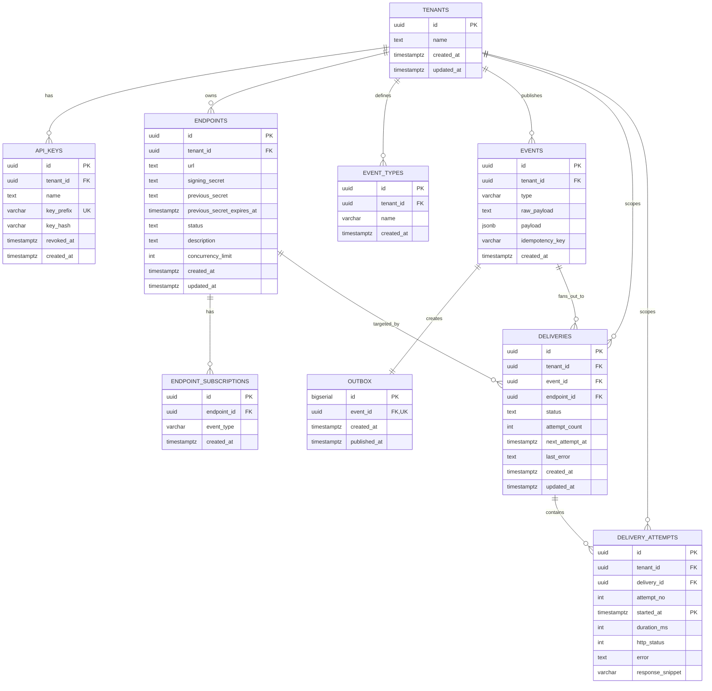

# HookRelay: Low-Level Design (LLD)

## 1. Monorepo Structure & Package Topology
The HookRelay monorepo utilizes npm workspaces with TypeScript strict mode:

- **`packages/shared` (`@hookrelay/shared`)**:
  - `config.ts`: Environment validation backed by Zod. `loadConfig()` parses variables and throws `ConfigValidationError` containing formatted field-level errors on failure.
  - `errors.ts`: RFC 7807 problem details format (`createProblemDetails`, `ProblemError`, and canonical URIs).
  - `logger.ts`: Pino structured logger with automatic path-based secret redaction (`apiKey`, `secret`, `signingSecret`, `password`, `authorization`).
  - `db/migrator.ts`: Transactional migration runner with PostgreSQL advisory locks, file checksum edit detection, and dynamic path resolution.
  - `types/index.ts`: Shared type contracts for health probes, service statuses, and domain entities.
- **`apps/api` (`@hookrelay/api`)**:
  - `server.ts`: Factory function `buildServer(dependencies: ApiDependencies)` with explicit dependency injection for `pgPool`, `redisClient`, `amqpConnection`, and `logger`.
  - `index.ts`: Production entrypoint executing `loadConfig()`, wiring real driver clients, and mounting listeners on `PORT`.
- **`apps/worker` (`@hookrelay/worker`)**:
  - `worker.ts`: `WorkerService` managing process lifecycle, checking connectivity to Postgres, Redis, and RabbitMQ, outputting the structured `worker_ready` event, and orchestrating clean resource teardown.
  - `index.ts`: CLI entrypoint handling process signals (`SIGTERM`, `SIGINT`).

## 2. Health & Readiness Protocol
- **Liveness (`GET /healthz`)**:
  - Purpose: Indicates whether the Node process is alive and accepting event-loop ticks.
  - Status: Always `200 OK` with JSON `{ "status": "ok", "timestamp": "<ISO>" }`.
- **Readiness (`GET /readyz`)**:
  - Purpose: Indicates whether the service has active, functional connections to all downstream infrastructure components.
  - Verification:
    - PostgreSQL: `SELECT 1` query execution.
    - Redis: `PING` -> `PONG` response check.
    - RabbitMQ: Active connection state check.
  - Response on success:
    - Status: `200 OK`
    - Body: `{ "status": "ready", "checks": { "postgres": "ok", "redis": "ok", "rabbitmq": "ok" }, "timestamp": "<ISO>" }`
  - Response on failure:
    - Status: `503 Service Unavailable`
    - Header: `Content-Type: application/problem+json`
    - Body: RFC 7807 problem structure detailing the degraded dependency.

## 3. Data Model

### Entity-Relationship Diagram

### Table Definitions & Design Decisions
1. **`tenants`**: Multi-tenant boundary roots.
2. **`api_keys`**:
   - `key_prefix`: Stored in plaintext (e.g. `hr_live_...`) for $O(1)$ index lookup.
   - `key_hash`: SHA-256 cryptographic hash. The plaintext secret is never stored or logged (Invariant 4).
   - `revoked_at`: Soft revocation timestamp.
3. **`endpoints`**:
   - `status`: Stored as `TEXT` with `CHECK (status IN ('active', 'paused', 'disabled'))`. Avoids Postgres enum alter-type friction.
   - `signing_secret` & `previous_secret`: Supports zero-downtime secret rotation. Application-layer encrypted via AES-256-GCM using `ENCRYPTION_KEY` and the endpoint UUID as GCM Additional Authenticated Data (AAD) (ADR 0004). Scrubbed to `NULL` upon soft deletion.
   - `previous_secret_expires_at`: Grace period deadline for old secret validation.
   - `deleted_at`: Soft delete timestamp column (ADR 0005). Deletion sets `deleted_at = now()`, `status = 'disabled'`, and scrubs secrets to `NULL`.
   - `version`: Monotonically increasing integer version for optimistic locking (`PATCH /v1/endpoints/:id`).
   - **Worker Operational Invariant (Day 3 & Day 4)**: The Day 3 fan-out consumer and Day 4 delivery worker must strictly skip endpoints where `deleted_at IS NOT NULL` as well as paused or disabled ones (`WHERE deleted_at IS NULL AND status = 'active'`).
4. **`events`**:
   - `raw_payload TEXT NOT NULL`: Preserves the exact bytes received over HTTP. HMAC-SHA256 signatures are computed exclusively over `raw_payload` (ADR 0002).
   - `payload JSONB NOT NULL`: Parsed JSON for indexing and inspection.
   - `idempotency_key`: Combined with `tenant_id` under `UNIQUE (tenant_id, idempotency_key)` to enforce Invariant 1 and Invariant 6.
5. **`outbox`**:
   - Core of the Transactional Outbox pattern (Invariant 2). Written in the same transaction as `events`.
   - Queues only contain `event_id` (Invariant 3).
6. **`deliveries`**:
   - Includes `tenant_id` for Invariant 6 (tenant isolation).
   - `UNIQUE (event_id, endpoint_id)` prevents duplicate fan-out rows.
7. **`delivery_attempts` (Partitioned)**:
   - Partitioned by month using declarative range partitioning: `PARTITION BY RANGE (started_at)`.
   - `PRIMARY KEY (id, started_at)` and `UNIQUE (delivery_id, attempt_no, started_at)` include the partition key `started_at` as required by PostgreSQL declarative partitioning.
   - `tenant_id` denormalized for direct tenant-scoped filtering.
   - `response_snippet` capped at 1024 bytes (`CHECK (octet_length(response_snippet) <= 1024)`).

### The Declarative Partitioning "Default Partition" Pitfall
In PostgreSQL declarative range partitioning, adding a `DEFAULT` catch-all partition creates a severe operational hazard:
- When a `DEFAULT` partition exists, creating or attaching any new monthly partition requires PostgreSQL to acquire an `ACCESS EXCLUSIVE` lock on the parent table and sequentially scan the entire `DEFAULT` partition to verify that no existing rows fall within the new partition's range.
- If clock drift or anomalies have already inserted rows matching the new range into `DEFAULT`, the `CREATE TABLE ... PARTITION OF` statement will immediately fail. Fixing it requires manually detaching, updating, and reattaching the default partition while blocking incoming writes.
- **HookRelay's Solution**: HookRelay omits the default partition and relies on proactive automated monthly partition generation via `create_attempts_partition(target_month)`. The migration creates the current and next 3 months dynamically, and a scheduled worker task extends partitions monthly ahead of time.

### Index Justification & Query Mapping
Every index in HookRelay is mapped directly to an operational query pattern:

| Index Name | Table & Columns | Target Query | Rationale |
| :--- | :--- | :--- | :--- |
| `idx_api_keys_lookup` | `api_keys (key_prefix) WHERE revoked_at IS NULL` | `SELECT * FROM api_keys WHERE key_prefix = $1 AND revoked_at IS NULL;` | Partial index on active keys; provides single-lookup $O(1)$ auth check on every inbound API call while ignoring revoked keys. |
| `idx_api_keys_tenant` | `api_keys (tenant_id, created_at DESC)` | `SELECT * FROM api_keys WHERE tenant_id = $1 ORDER BY created_at DESC;` | Invariant 6 compliance; allows tenant dashboard to list keys sorted by recency without table scans. |
| `idx_endpoints_tenant_status` | `endpoints (tenant_id, status)` | `SELECT * FROM endpoints WHERE tenant_id = $1 AND status = 'active';` | Fan-out engine query; quickly locates active subscriber endpoints for a tenant during event publication. |
| `idx_endpoints_tenant_list` | `endpoints (tenant_id, created_at DESC, id DESC) WHERE deleted_at IS NULL` | `SELECT * FROM endpoints WHERE tenant_id = $1 AND deleted_at IS NULL AND (created_at, id) < ($2, $3) ORDER BY created_at DESC, id DESC LIMIT $limit + 1;` | Keyset (cursor) pagination query; provides $O(\log n + \text{limit})$ B-tree index traversal ordered by microsecond timestamp and tie-broken by UUID under Invariant 6 isolation. |
| `idx_endpoints_tenant_active` | `endpoints (tenant_id) WHERE deleted_at IS NULL AND status = 'active'` | `SELECT * FROM endpoints WHERE tenant_id = $1 AND deleted_at IS NULL AND status = 'active';` | Fan-out engine query; locates active subscriber endpoints for a tenant during event publication, skipping deleted/paused/disabled endpoints. |
| `idx_endpoint_subscriptions_match` | `endpoint_subscriptions (event_type, endpoint_id)` | `SELECT endpoint_id FROM endpoint_subscriptions WHERE event_type = $1 OR event_type = '*';` | Subscriber resolution query; finds which endpoints subscribe to an event type during fan-out. Note: Lookups by `endpoint_id` (e.g. `GET /subscriptions`) are already served by `uq_endpoint_subscriptions (endpoint_id, event_type)`. |
| `idx_events_tenant_created` | `events (tenant_id, created_at DESC)` | `SELECT * FROM events WHERE tenant_id = $1 ORDER BY created_at DESC LIMIT $2;` | Invariant 6 compliance; paginated tenant event log inspection in API/dashboard. |
| `idx_outbox_unpublished` | `outbox (created_at ASC) WHERE published_at IS NULL` | `SELECT event_id FROM outbox WHERE published_at IS NULL ORDER BY created_at ASC LIMIT $1 FOR UPDATE SKIP LOCKED;` | Outbox relay poller query (Invariant 2); partial index guarantees sub-millisecond lookups regardless of how many millions of historical events have already been published. |
| `idx_deliveries_tenant_status_created` | `deliveries (tenant_id, status, created_at DESC)` | `SELECT * FROM deliveries WHERE tenant_id = $1 AND status = $2 ORDER BY created_at DESC LIMIT $3;` | Primary tenant delivery log query; matches equality filter on `tenant_id` and `status` and supplies pre-sorted order on `created_at DESC` without in-memory sort. |
| `idx_deliveries_due_retry` | `deliveries (next_attempt_at ASC) WHERE status = 'failed'` | `SELECT * FROM deliveries WHERE status = 'failed' AND next_attempt_at <= now() ORDER BY next_attempt_at ASC LIMIT $1;` | Retry scheduler query; partial index locating failed deliveries ready for exponential backoff redelivery. |
| `idx_delivery_attempts_delivery_order` | `delivery_attempts (delivery_id, attempt_no ASC)` | `SELECT * FROM delivery_attempts WHERE delivery_id = $1 ORDER BY attempt_no ASC;` | Audit log query; retrieves full chronological attempt history for a specific delivery. |
| `idx_delivery_attempts_tenant_time` | `delivery_attempts (tenant_id, started_at DESC)` | `SELECT * FROM delivery_attempts WHERE tenant_id = $1 AND started_at >= $2 ORDER BY started_at DESC;` | Invariant 6 compliance; allows tenant-scoped inspection of delivery attempt timelines and error analytics. |

## 4. Migration Runner Architecture
- **Choice of Plain SQL + Tiny Runner**:
  - Zero external dependencies: Uses existing `pg` driver.
  - Native Postgres 16 features: Declarative partitioning and partial index syntax are fully preserved without ORM/migration DSL impedance.
  - Concurrency safety: Uses `pg_advisory_lock(837261947261)` to ensure only one runner executes migrations across multi-node deployments.
  - Tamper detection: Hashes `.sql` file contents with SHA-256 and records them in `schema_migrations`. If an applied file is modified, the runner halts with `MigrationChecksumMismatchError`.
  - Transactional isolation: Each file is wrapped in an atomic `BEGIN ... COMMIT` block.
  - Note on `CONCURRENTLY`: PostgreSQL forbids `CREATE INDEX CONCURRENTLY` inside transaction blocks; standard migrations run within transactions, whereas zero-downtime concurrent index builds must be executed outside transaction blocks.

## 5. Outbound URL Safety & SSRF Defense Architecture (Invariant 5)

HookRelay implements a multi-layered defense-in-depth model to prevent Server-Side Request Forgery (SSRF) and protect internal networks, cloud metadata services, and local infrastructure:

### 5.1 Architecture & Component Division
The safety module in `@hookrelay/shared` (`src/ssrf/index.ts`) provides two core primitives:
1. `validateEndpointUrl(url, options)`:
   - Validates URL syntax, scheme (`https:` required; `http:` allowed only when `ALLOW_HTTP=true`), port numbers, credentials in authority, and hostname characteristics.
   - Resolves all DNS records (`A` and `AAAA`) using `dns.promises.lookup(host, { all: true, verbatim: true })` and validates every resolved address against the IP access rules.
   - Normalizes the URL string for database storage.
2. `isAddressAllowed(ip, options)`:
   - Evaluates a single canonical IP address (IPv4 or IPv6) against a comprehensive blocklist.
   - Accepts only canonical IP literals validated via `net.isIP(ip)`. Zone IDs (e.g. `fe80::1%en0`) and non-canonical forms are strictly rejected.

### 5.2 Registration Validation is Advisory Only
Validation performed at endpoint registration (`POST /v1/endpoints`) is strictly **advisory** and serves as a fast-fail UX check:
- **DNS Rebinding & TTL Expiry Hazard**: An attacker can register a domain pointing to an innocent public IP (passing registration checks) and configure an authoritative DNS server with a low TTL (e.g., 0–5 seconds). When the webhook delivery worker attempts delivery later, the DNS server responds with `169.254.169.254` (cloud metadata) or `10.0.0.1` (internal network).
- **Enforcement Mandate**: Day 4 delivery workers MUST re-validate the target IP address immediately prior to or during connection establishment (e.g., via a custom HTTP agent or socket `lookup` hook). An endpoint passing registration validation is never assumed safe at runtime.

### 5.3 IP Filtering & Default-Deny Policy
- **IPv4 Filtering**: Uses `node:net.BlockList` covering the entire IANA special-purpose registry:
  - Private networks: `10.0.0.0/8`, `172.16.0.0/12`, `192.168.0.0/16` (RFC 1918).
  - Loopback: `127.0.0.0/8` (RFC 1122).
  - Link-local & cloud metadata: `169.254.0.0/16` (RFC 3927, AWS/GCP/DigitalOcean metadata) and `168.63.129.16/32` (Azure wire server).
  - Carrier-Grade NAT (CGNAT): `100.64.0.0/10` (RFC 6598).
  - Multicast & broadcast: `224.0.0.0/4`, `255.255.255.255/32`.
  - Documentation & benchmark: `192.0.2.0/24`, `198.51.100.0/24`, `203.0.113.0/24`, `198.18.0.0/15`.
  - Additional IANA reservations: `192.88.99.0/24` (6to4 relay), `192.31.196.0/24` (AS112-v4), `192.52.193.0/24` (AMT), `192.175.48.0/24` (Direct Delegation AS112), `0.0.0.0/8` (Current network).
- **IPv6 Default-Deny**:
  - Global Unicast range `2000::/3` is the only permitted IPv6 space.
  - All special-purpose ranges carved out of `2000::/3` are explicitly blocked: `2001::/23` (including Teredo `2001::/32` and Documentation `2001:db8::/32`), `2002::/16` (6to4), and `64:ff9b:1::/48` (Local-use IPv4/IPv6 translation).
  - All non-global spaces are blocked: `::1/128` (loopback), `::/128` (unspecified), `fc00::/7` (Unique Local Address / ULA), `fe80::/10` (link-local), `fec0::/10` (site-local), `ff00::/8` (multicast), and `::/96` (IPv4-compatible).
  - IPv4-mapped IPv6 addresses (`::ffff:0:0/96`, e.g. `::ffff:127.0.0.1` or `::ffff:169.254.169.254`) have their inner IPv4 address extracted and evaluated against the full IPv4 blocklist.

### 5.4 Port Policy
- **Permitted Ports**:
  - Standard web ports: `443` (and `80` only when `allowHttp` is explicitly enabled).
  - Unprivileged ports: Any port $\ge 1024$ and $\le 65535$, excluding sensitive service ports.
- **Sensitive Port Blocklist**:
  - Remote access & management: `22` (SSH), `23` (Telnet), `3389` (RDP).
  - Infrastructure & databases: `2375`, `2376` (Docker daemon), `3306` (MySQL), `5432` (PostgreSQL), `6379` (Redis), `11211` (Memcached), `27017` (MongoDB), `9200`, `9300` (Elasticsearch), `5672`, `15672` (RabbitMQ).
  - Core network services: `25`, `465`, `587` (SMTP/mail), `53` (DNS), `445` (SMB), `137`, `138`, `139` (NetBIOS), `161` (SNMP), `389`, `636` (LDAP).

### 5.5 True Backstop: Network-Level Egress Policies
Application-level URL validation and socket-level IP checks represent the first two lines of defense. However, **application code is not the ultimate security boundary**:
- Misconfigurations, 0-day resolver bugs, or container escapes could bypass runtime checks.
- In production, the **true and non-negotiable backstop** is network-level egress control:
  - **Kubernetes NetworkPolicy / Calico**: Deny worker pod egress to private CIDRs (`10.0.0.0/8`, `172.16.0.0/12`, `192.168.0.0/16`), link-local (`169.254.0.0/16`), and internal VPC service subnets.
  - **Cloud VPC / Firewall Rules**: Egress gateway or NAT instances restricting outbound traffic exclusively to the public Internet, with explicit drops on internal metadata endpoints (`169.254.169.254`, `168.63.129.16`).
