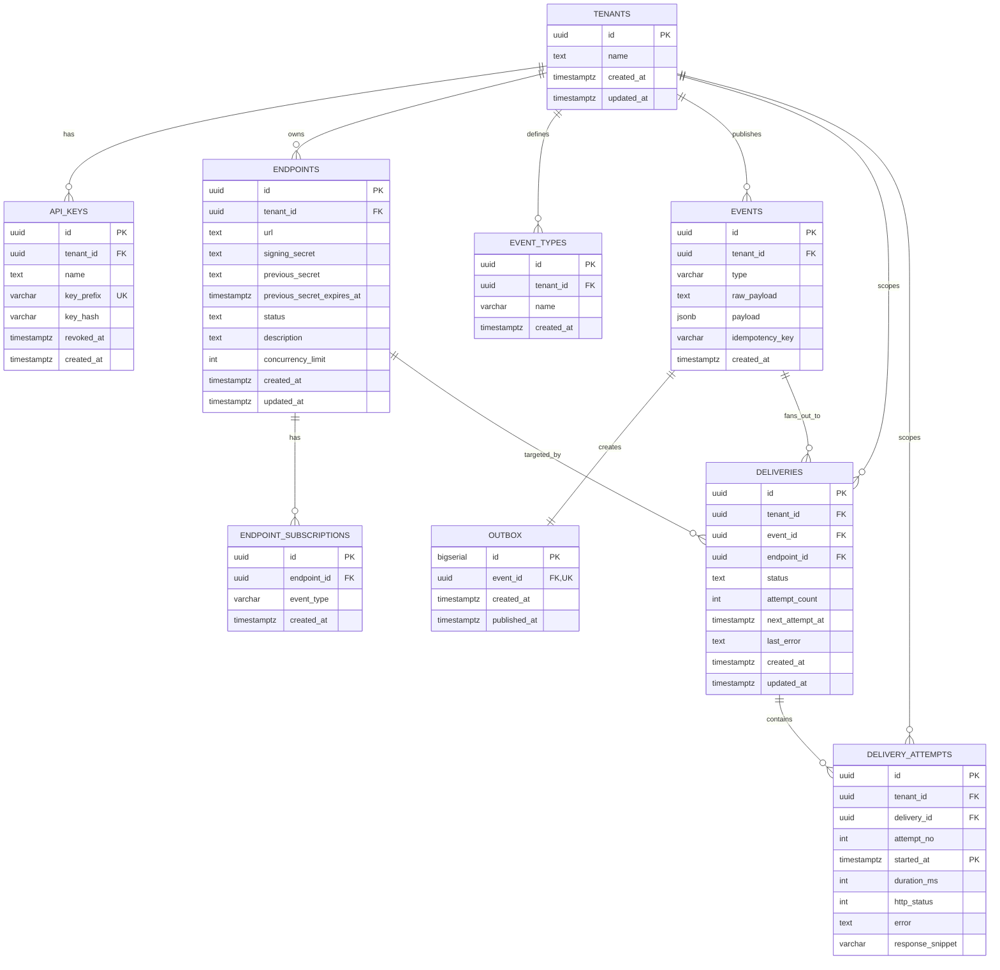

# HookRelay: Low-Level Design (LLD)

## 1. Monorepo Structure & Package Topology
The HookRelay monorepo utilizes npm workspaces with TypeScript strict mode:

- **`packages/shared` (`@hookrelay/shared`)**:
  - `config.ts`: Environment validation backed by Zod. `loadConfig()` parses variables and throws `ConfigValidationError` containing formatted field-level errors on failure.
  - `errors.ts`: RFC 7807 problem details format (`createProblemDetails`, `ProblemError`, and canonical URIs).
  - `logger.ts`: Pino structured logger with automatic path-based secret redaction (`apiKey`, `secret`, `signingSecret`, `password`, `authorization`).
  - `db/migrator.ts`: Transactional migration runner with PostgreSQL advisory locks, file checksum edit detection, and dynamic path resolution.
  - `types/index.ts`: Shared type contracts for health probes, service statuses, and domain entities.
- **`apps/api` (`@hookrelay/api`)**:
  - `server.ts`: Factory function `buildServer(dependencies: ApiDependencies)` with explicit dependency injection for `pgPool`, `redisClient`, `amqpConnection`, and `logger`.
  - `index.ts`: Production entrypoint executing `loadConfig()`, wiring real driver clients, and mounting listeners on `PORT`.
- **`apps/worker` (`@hookrelay/worker`)**:
  - `worker.ts`: `WorkerService` managing process lifecycle, checking connectivity to Postgres, Redis, and RabbitMQ, outputting the structured `worker_ready` event, and orchestrating clean resource teardown.
  - `index.ts`: CLI entrypoint handling process signals (`SIGTERM`, `SIGINT`).

## 2. Health & Readiness Protocol
- **Liveness (`GET /healthz`)**:
  - Purpose: Indicates whether the Node process is alive and accepting event-loop ticks.
  - Status: Always `200 OK` with JSON `{ "status": "ok", "timestamp": "<ISO>" }`.
- **Readiness (`GET /readyz`)**:
  - Purpose: Indicates whether the service has active, functional connections to all downstream infrastructure components.
  - Verification:
    - PostgreSQL: `SELECT 1` query execution.
    - Redis: `PING` -> `PONG` response check.
    - RabbitMQ: Active connection state check.
  - Response on success:
    - Status: `200 OK`
    - Body: `{ "status": "ready", "checks": { "postgres": "ok", "redis": "ok", "rabbitmq": "ok" }, "timestamp": "<ISO>" }`
  - Response on failure:
    - Status: `503 Service Unavailable`
    - Header: `Content-Type: application/problem+json`
    - Body: RFC 7807 problem structure detailing the degraded dependency.

## 3. Data Model

### Entity-Relationship Diagram

### Table Definitions & Design Decisions
1. **`tenants`**: Multi-tenant boundary roots.
2. **`api_keys`**:
   - `key_prefix`: Stored in plaintext (e.g. `hr_live_...`) for $O(1)$ index lookup.
   - `key_hash`: SHA-256 cryptographic hash. The plaintext secret is never stored or logged (Invariant 4).
   - `revoked_at`: Soft revocation timestamp.
3. **`endpoints`**:
   - `status`: Stored as `TEXT` with `CHECK (status IN ('active', 'paused', 'disabled'))`. Avoids Postgres enum alter-type friction.
   - `signing_secret` & `previous_secret`: Supports zero-downtime secret rotation.
   - `previous_secret_expires_at`: Grace period deadline for old secret validation.
4. **`events`**:
   - `raw_payload TEXT NOT NULL`: Preserves the exact bytes received over HTTP. HMAC-SHA256 signatures are computed exclusively over `raw_payload` (ADR 0002).
   - `payload JSONB NOT NULL`: Parsed JSON for indexing and inspection.
   - `idempotency_key`: Combined with `tenant_id` under `UNIQUE (tenant_id, idempotency_key)` to enforce Invariant 1 and Invariant 6.
5. **`outbox`**:
   - Core of the Transactional Outbox pattern (Invariant 2). Written in the same transaction as `events`.
   - Queues only contain `event_id` (Invariant 3).
6. **`deliveries`**:
   - Includes `tenant_id` for Invariant 6 (tenant isolation).
   - `UNIQUE (event_id, endpoint_id)` prevents duplicate fan-out rows.
7. **`delivery_attempts` (Partitioned)**:
   - Partitioned by month using declarative range partitioning: `PARTITION BY RANGE (started_at)`.
   - `PRIMARY KEY (id, started_at)` and `UNIQUE (delivery_id, attempt_no, started_at)` include the partition key `started_at` as required by PostgreSQL declarative partitioning.
   - `tenant_id` denormalized for direct tenant-scoped filtering.
   - `response_snippet` capped at 1024 bytes (`CHECK (octet_length(response_snippet) <= 1024)`).

### The Declarative Partitioning "Default Partition" Pitfall
In PostgreSQL declarative range partitioning, adding a `DEFAULT` catch-all partition creates a severe operational hazard:
- When a `DEFAULT` partition exists, creating or attaching any new monthly partition requires PostgreSQL to acquire an `ACCESS EXCLUSIVE` lock on the parent table and sequentially scan the entire `DEFAULT` partition to verify that no existing rows fall within the new partition's range.
- If clock drift or anomalies have already inserted rows matching the new range into `DEFAULT`, the `CREATE TABLE ... PARTITION OF` statement will immediately fail. Fixing it requires manually detaching, updating, and reattaching the default partition while blocking incoming writes.
- **HookRelay's Solution**: HookRelay omits the default partition and relies on proactive automated monthly partition generation via `create_attempts_partition(target_month)`. The migration creates the current and next 3 months dynamically, and a scheduled worker task extends partitions monthly ahead of time.

### Index Justification & Query Mapping
Every index in HookRelay is mapped directly to an operational query pattern:

| Index Name | Table & Columns | Target Query | Rationale |
| :--- | :--- | :--- | :--- |
| `idx_api_keys_lookup` | `api_keys (key_prefix) WHERE revoked_at IS NULL` | `SELECT * FROM api_keys WHERE key_prefix = $1 AND revoked_at IS NULL;` | Partial index on active keys; provides single-lookup $O(1)$ auth check on every inbound API call while ignoring revoked keys. |
| `idx_api_keys_tenant` | `api_keys (tenant_id, created_at DESC)` | `SELECT * FROM api_keys WHERE tenant_id = $1 ORDER BY created_at DESC;` | Invariant 6 compliance; allows tenant dashboard to list keys sorted by recency without table scans. |
| `idx_endpoints_tenant_status` | `endpoints (tenant_id, status)` | `SELECT * FROM endpoints WHERE tenant_id = $1 AND status = 'active';` | Fan-out engine query; quickly locates active subscriber endpoints for a tenant during event publication. |
| `idx_endpoint_subscriptions_match` | `endpoint_subscriptions (event_type, endpoint_id)` | `SELECT endpoint_id FROM endpoint_subscriptions WHERE event_type = $1 OR event_type = '*';` | Subscriber resolution query; finds which endpoints subscribe to an event type during fan-out. |
| `idx_events_tenant_created` | `events (tenant_id, created_at DESC)` | `SELECT * FROM events WHERE tenant_id = $1 ORDER BY created_at DESC LIMIT $2;` | Invariant 6 compliance; paginated tenant event log inspection in API/dashboard. |
| `idx_outbox_unpublished` | `outbox (created_at ASC) WHERE published_at IS NULL` | `SELECT event_id FROM outbox WHERE published_at IS NULL ORDER BY created_at ASC LIMIT $1 FOR UPDATE SKIP LOCKED;` | Outbox relay poller query (Invariant 2); partial index guarantees sub-millisecond lookups regardless of how many millions of historical events have already been published. |
| `idx_deliveries_tenant_status_created` | `deliveries (tenant_id, status, created_at DESC)` | `SELECT * FROM deliveries WHERE tenant_id = $1 AND status = $2 ORDER BY created_at DESC LIMIT $3;` | Primary tenant delivery log query; matches equality filter on `tenant_id` and `status` and supplies pre-sorted order on `created_at DESC` without in-memory sort. |
| `idx_deliveries_due_retry` | `deliveries (next_attempt_at ASC) WHERE status = 'failed'` | `SELECT * FROM deliveries WHERE status = 'failed' AND next_attempt_at <= now() ORDER BY next_attempt_at ASC LIMIT $1;` | Retry scheduler query; partial index locating failed deliveries ready for exponential backoff redelivery. |
| `idx_delivery_attempts_delivery_order` | `delivery_attempts (delivery_id, attempt_no ASC)` | `SELECT * FROM delivery_attempts WHERE delivery_id = $1 ORDER BY attempt_no ASC;` | Audit log query; retrieves full chronological attempt history for a specific delivery. |
| `idx_delivery_attempts_tenant_time` | `delivery_attempts (tenant_id, started_at DESC)` | `SELECT * FROM delivery_attempts WHERE tenant_id = $1 AND started_at >= $2 ORDER BY started_at DESC;` | Invariant 6 compliance; allows tenant-scoped inspection of delivery attempt timelines and error analytics. |

## 4. Migration Runner Architecture
- **Choice of Plain SQL + Tiny Runner**:
  - Zero external dependencies: Uses existing `pg` driver.
  - Native Postgres 16 features: Declarative partitioning and partial index syntax are fully preserved without ORM/migration DSL impedance.
  - Concurrency safety: Uses `pg_advisory_lock(837261947261)` to ensure only one runner executes migrations across multi-node deployments.
  - Tamper detection: Hashes `.sql` file contents with SHA-256 and records them in `schema_migrations`. If an applied file is modified, the runner halts with `MigrationChecksumMismatchError`.
  - Transactional isolation: Each file is wrapped in an atomic `BEGIN ... COMMIT` block.
  - Note on `CONCURRENTLY`: PostgreSQL forbids `CREATE INDEX CONCURRENTLY` inside transaction blocks; standard migrations run within transactions, whereas zero-downtime concurrent index builds must be executed outside transaction blocks.
